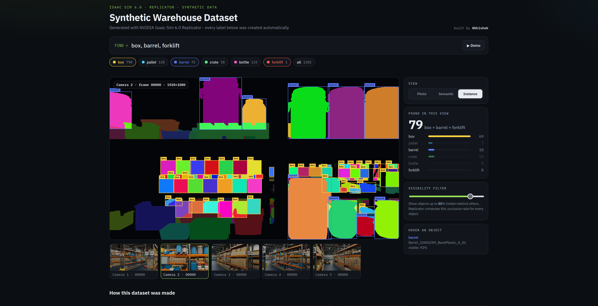
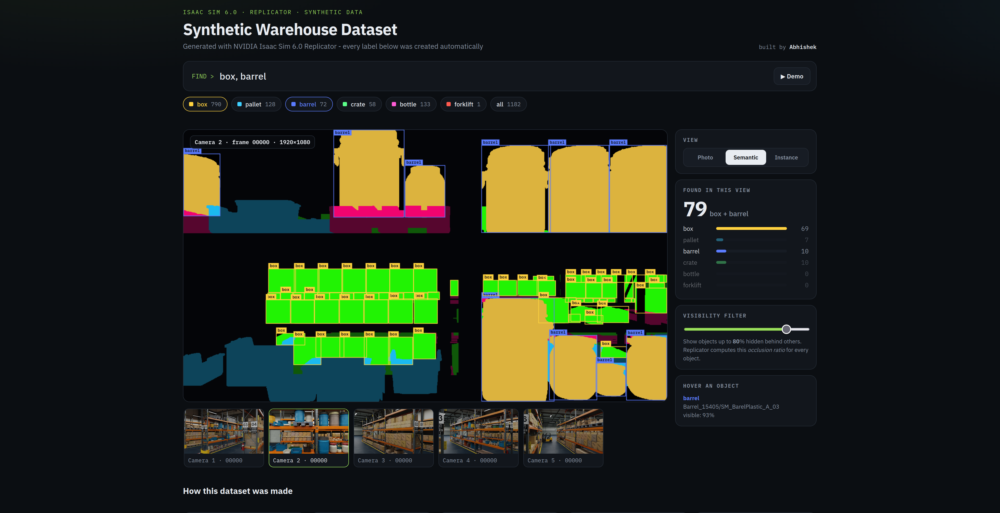
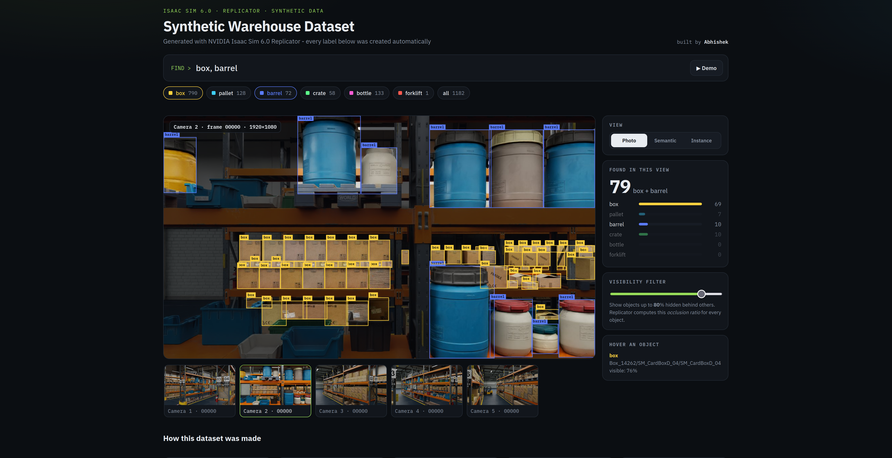
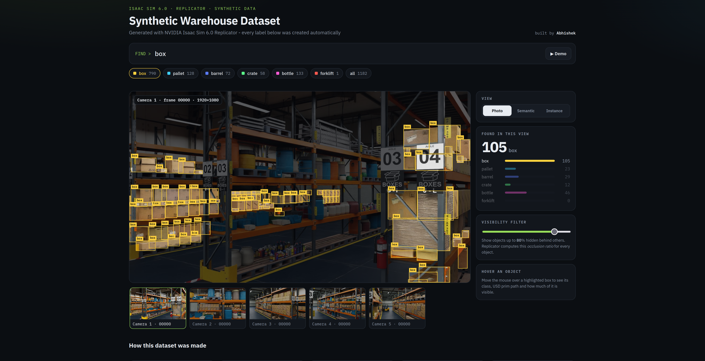
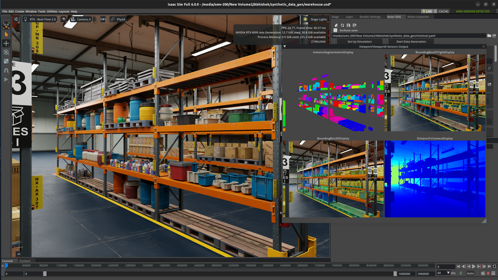
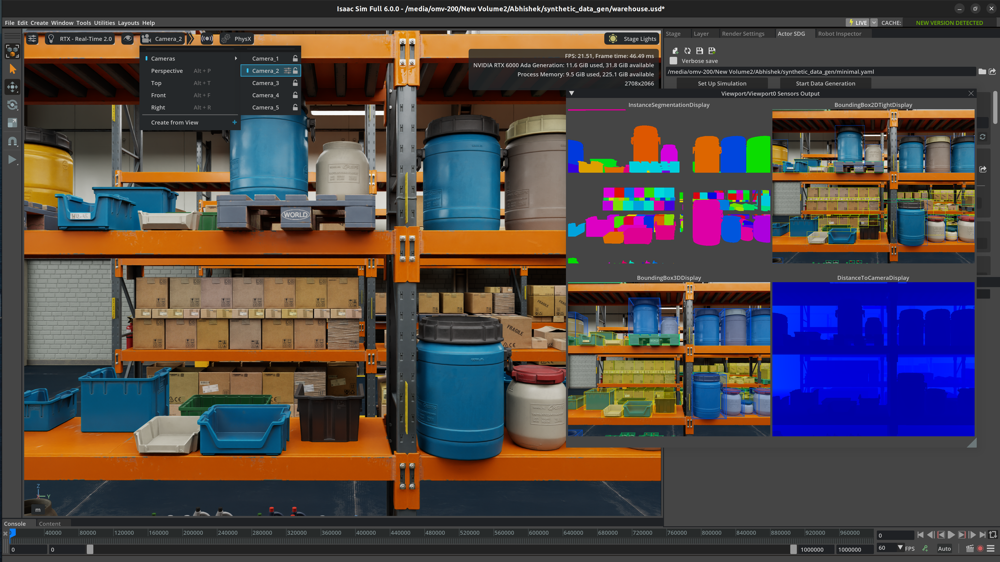
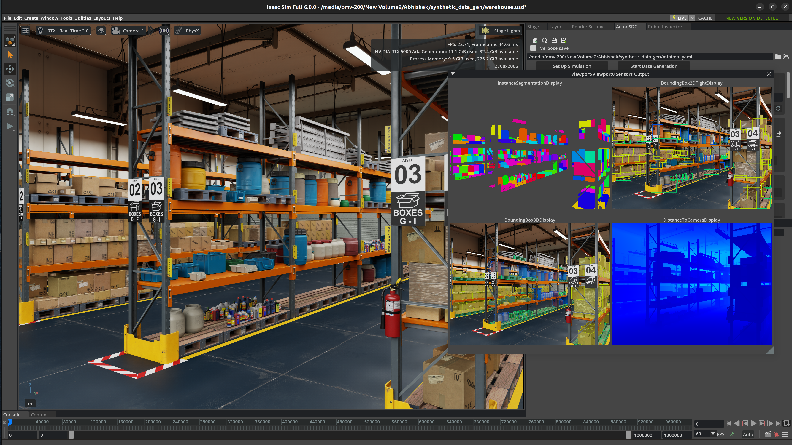
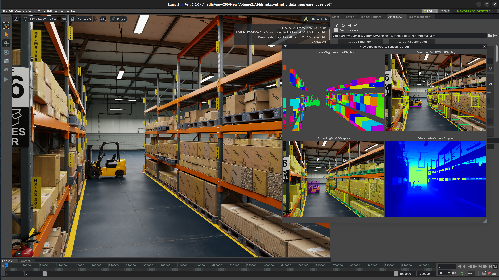

# Synthetic Warehouse Dataset with NVIDIA Isaac Sim 6.0

**Live demo:** https://vedsom.github.io/Synthetic_data_generation_Isaac_Sim/
Type `box`, `pallet`, `barrel`, `crate`, `bottle`, `forklift` or `all` and every matching object lights up with its ground-truth bounding box.



## Gallery

| | |
|---|---|
|  |  |
|  |  |
|  |  |
|  |  |

## What this is
An end-to-end **synthetic data generation (SDG)** pipeline built in NVIDIA Isaac Sim 6.0:
a USD warehouse scene, semantic labels on every object, virtual cameras along the aisles, and
**Replicator / Actor SDG** rendering pixel-perfect annotations - with **zero manual labelling**.

| Output per frame | Format |
|---|---|
| RGB image | PNG |
| Semantic segmentation (per class) | PNG + JSON |
| Instance segmentation (per object) | PNG + JSON |
| 2D tight/loose + 3D bounding boxes, occlusion ratio | JSON (`object_detection/`) |
| Depth (distance to camera) | NPY |
| Camera intrinsics / extrinsics | JSON |

**First run:** 5 cameras · 1920×1080 · 6 classes · ~1,200 labelled objects in 5 views
(box 790 · bottle 133 · pallet 128 · barrel 72 · crate 58 · forklift 1).

## Pipeline
1. **Explore the scene** - find object names and structure in the USD stage (`scripts/isaac/01`, `02`)
2. **Labels** - check / add semantic `class` labels on meshes (`03`, `04`)
3. **Cameras** - save viewport views as cameras along the aisles (`05`)
4. **Preview** - render one frame and draw ground-truth boxes (`06`)
5. **Generate** - Actor SDG + IRABasicWriter with a semantic filter (`07`, `08`, `configs/`)
6. **Post-process** - draw boxes, convert to YOLO (`scripts/post/`)
7. **Explore** - build the interactive web page (`explorer/build_explorer.py` -> `docs/index.html`)

## Run it
```bash
# Isaac Sim: run scripts/isaac/*.py in Window > Script Editor, record with the Actor SDG tab
# then, in any Python with Pillow:
python3 explorer/build_explorer.py        # edit RUN at the top first
xdg-open docs/index.html
```

## Lessons learned (things that cost me time)
- **The scene was already labelled.** NVIDIA's Simple_Warehouse ships with `class` labels on ~3,400 meshes
  (incl. `rack`, `wall`, `floor`). Always inspect existing labels before adding your own.
- **Names lie.** Pallets are `SM_PaletteA`, barrels are `SM_BarelPlastic` (one "r") - search by real prim names.
- **Label meshes, not materials.** Name searches also match `MI_*` materials and `Looks` folders.
- **Semantic filter > cleanup.** `class:box|pallet|...;id:*` keeps only the classes you care about;
  walls/floor/racks become background.
- **Actor SDG gotchas:** `semantic_types` and `semantic_filter_predicate` are mutually exclusive;
  an empty `sensor.root_prim_path` fails validation; press Enter in UI fields or values aren't saved;
  per-object boxes in `object_detection/` need **Object Info Bounding Box 2D Tight** enabled.
- **numpy bug:** `np.save() got an unexpected keyword argument 'fix_imports'` breaks `.npy` outputs (depth) -
  see `scripts/isaac/07_numpy_save_patch.py`.
- **Dataset hygiene:** one forklift seen by one camera -> all forklift labels ended up in validation, none in training.

## Next
- Domain randomisation: camera jitter, lighting, moving the forklift, hiding objects
- Separate validation run from new camera positions
- Sim-to-real check on real warehouse photos

---
Scene assets © NVIDIA (Isaac Sim sample content) - not redistributed here; only scripts and rendered previews.
